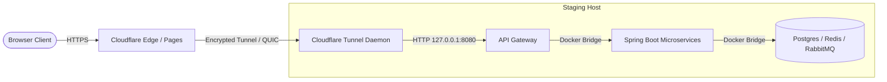

# LUMIÈRE — Staging Credentials & Environment Setup Guide

**Architecture:** Cloudflare Pages (Frontend) + Oracle Cloud Always Free Ampere A1 (Backend)  
**Security Profile:** Private Staging Cluster (Zero Development Credentials, Fail-Closed Security)  
**Budget:** ₹0 First  

---

## 1. Overview & Architecture Boundary

The LUMIÈRE staging environment operates with a decoupled edge-and-cloud architecture:

1. **Frontend (Cloudflare Pages):**
   - Serves React 18 SPA as static assets compiled by Vite.
   - Operates on Cloudflare's global edge network (e.g., `https://lumiere-staging.pages.dev` or custom domain).
   - Connects to the backend via HTTPS XHR/Fetch requests.
   - SPA routing is managed by [`services/frontend/public/_redirects`](file:///c:/Users/Asus/OneDrive/Desktop/Production-Grade%20E-Commerce%20Microservices%20Platform%20on%20Kubernetes/Production-Grade-E-commerce-Microservices-Platform-on-Kubernetes/services/frontend/public/_redirects).
2. **Backend (Oracle Cloud Always Free Ampere A1 ARM64 VM):**
   - Hosts all 7 backend microservices (`api-gateway`, `auth`, `product`, `cart`, `order`, `payment`, `notification`).
   - Runs supporting data tiers: PostgreSQL 16, Redis 7, RabbitMQ 3, and Mailpit.
   - Orchestrated via [`docker/docker-compose.staging.yml`](file:///c:/Users/Asus/OneDrive/Desktop/Production-Grade%20E-Commerce%20Microservices%20Platform%20on%20Kubernetes/Production-Grade-E-commerce-Microservices-Platform-on-Kubernetes/docker/docker-compose.staging.yml).
   - Completely isolated: PostgreSQL, Redis, and RabbitMQ have **zero public host ports exposed**.
   - API Gateway binds to `127.0.0.1:8080`, intended to sit behind a Cloudflare Tunnel or local Nginx reverse proxy.

---

## 2. Environment Variables Specification

The staging environment strictly enforces fail-closed variable interpolation (`:?`). The following exact variable names are required:

| Variable Name | Required By | Format & Constraints | Purpose |
|---|---|---|---|
| `DB_USER` | `postgres`, all microservices | Alphanumeric identifier (e.g., `lumiere_staging_user`) | PostgreSQL application user |
| `DB_PASSWORD` | `postgres`, all microservices | High-entropy alphanumeric (48+ chars, >280 bits entropy) | PostgreSQL user password |
| `DB_NAME` | `postgres`, all microservices | Alphanumeric (default: `ecommerce_db`) | Primary database name |
| `REDIS_PASSWORD` | `redis`, `auth`, `product`, `cart` | High-entropy alphanumeric (48+ chars, >280 bits entropy) | Redis `requirepass` auth token |
| `RABBITMQ_USER` | `rabbitmq`, microservices | Alphanumeric identifier (e.g., `lumiere_staging_rabbit`) | Dedicated message broker user |
| `RABBITMQ_PASSWORD` | `rabbitmq`, microservices | High-entropy alphanumeric (48+ chars, >280 bits entropy) | RabbitMQ application password |
| `JWT_SECRET` | All 7 microservices | High-entropy alphanumeric (64 chars, >380 bits entropy, min 32 UTF-8 bytes) | HMAC-SHA256 JWT signing key |
| `COOKIE_SECURE` | `auth-service` | Boolean (`true`) | Enforces `Secure` flag on refresh & CSRF cookies |
| `COOKIE_SAME_SITE` | `auth-service` | `None` (cross-site) or `Lax` (shared apex domain) | Browser cookie handling policy |
| `CORS_ALLOWED_ORIGINS`| `api-gateway`, `auth-service` | Comma-separated HTTPS URLs (e.g., `https://lumiere-staging.pages.dev`) | Whitelisted browser frontend origins |
| `CORS_ALLOWED_ORIGIN_PATTERNS`| `api-gateway` | Wildcard pattern (e.g., `https://*.pages.dev`) | Allows dynamic Cloudflare preview builds |
| `SPRING_PROFILES_ACTIVE` | All microservices | String (`prod`) | Enforces fail-closed production security profile |
| `ADMIN_EMAIL` | `auth-service` | Valid email address | Optional bootstrap admin account email |
| `ADMIN_PASSWORD` | `auth-service` | High-entropy alphanumeric (48+ chars, >280 bits entropy) | Optional bootstrap admin account password |
| `ENABLE_INTERNAL_CHECKOUT` | `api-gateway`, `cart`, `order`, `payment` | Boolean (`false`) | Enforces luxury editorial referral model |
| `JAVA_OPTS` | All Java microservices | JVM flags (`-XX:+UseZGC -Xms128m -Xmx256m`) | Memory tuning for OCI Ampere A1 (ARM64) |

---

## 3. Local Secret Generation Script

A dedicated PowerShell utility is located at [`scripts/generate-staging-secrets.ps1`](file:///c:/Users/Asus/OneDrive/Desktop/Production-Grade%20E-Commerce%20Microservices%20Platform%20on%20Kubernetes/Production-Grade-E-commerce-Microservices-Platform-on-Kubernetes/scripts/generate-staging-secrets.ps1).

### 3.1 Security Principles of the Generator
- **Operating-System CSPRNG:** Uses `[System.Security.Cryptography.RandomNumberGenerator]` to produce high-entropy cryptographic bytes.
- **Strict Character Safety:** Uses alphanumeric charsets (`[A-Za-z0-9]`) to avoid shell metacharacters (`$`, `"`, `'`, `#`, `\`, newlines) that break Docker Compose, bash, or Spring property parsers.
- **Zero Information Leak:** Never echoes, logs, or prints secret values to the terminal or console.
- **Windows NTFS Permission Hardening:** Automatically executes `icacls.exe` to strip inherited permissions and grant Full Control strictly to the current Windows user (`$env:USERNAME`).
- **Overwrite Protection:** Aborts with an error if `.env.staging` already exists unless explicitly passed the `-Force` switch.

### 3.2 Execution Instructions

Open a PowerShell terminal on Windows 11 and run:

```powershell
# Step 1: Navigate to repository root
cd "c:\Users\Asus\OneDrive\Desktop\Production-Grade E-Commerce Microservices Platform on Kubernetes\Production-Grade-E-commerce-Microservices-Platform-on-Kubernetes"

# Step 2: Validate generation logic without writing to disk
powershell -ExecutionPolicy Bypass -File .\scripts\generate-staging-secrets.ps1 -DryRun

# Step 3: Generate the actual .env.staging file
powershell -ExecutionPolicy Bypass -File .\scripts\generate-staging-secrets.ps1 `
    -StagingFrontendOrigin "https://lumiere-staging.pages.dev" `
    -CustomStagingDomain "https://staging.yourdomain.com" `
    -AdminEmail "admin@staging.lumiere.internal"
```

### 3.3 Overwrite Protection & Safe Re-generation
If `.env.staging` already exists, running the script will safely fail:
```text
Target file '...\.env.staging' already exists. To prevent accidental secret loss or credential divergence, this script will not overwrite it without the -Force switch.
```
To explicitly regenerate all credentials:
```powershell
powershell -ExecutionPolicy Bypass -File .\scripts\generate-staging-secrets.ps1 -Force
```

---

## 4. Cloudflare Pages Configuration Guide

Configure the frontend build settings in the **Cloudflare Dashboard** (*Workers & Pages → Pages → Create Project*):

### 4.1 Build & Deployment Settings

| Setting | Value | Notes |
|---|---|---|
| **Framework preset** | `Vite` | Select Vite from the dropdown |
| **Root directory** | `services/frontend` | Tells Cloudflare to run inside the frontend subfolder |
| **Build command** | `npm run build` | Compiles TypeScript and runs Vite production build |
| **Build output directory** | `dist` | Contains compiled HTML, CSS, JS, and `_redirects` |
| **Node.js Version** | `20` or `22` | Set `NODE_VERSION=20` in Environment Variables |

### 4.2 Cloudflare Pages Environment Variables

Set in **Project Settings → Environment Variables**:

| Variable | Staging Value | Purpose |
|---|---|---|
| `VITE_API_GATEWAY_URL` | `https://api-staging.yourdomain.com` | Target backend URL embedded into client-side JS bundle |
| `VITE_ENABLE_INTERNAL_CHECKOUT` | `false` | Disables internal cart, checkout, and mock payment buttons |
| `NODE_VERSION` | `20` | Specifies modern Node runtime for Cloudflare build container |

> [!CAUTION]
> **CRITICAL SECURITY RULE: NEVER PUT SECRETS IN CLOUDFLARE PAGES**  
> Every variable starting with `VITE_*` is embedded directly into client-side JavaScript (`dist/assets/*.js`) during build and is completely visible to any website visitor via browser Developer Tools.
> 
> **NEVER** configure `DB_PASSWORD`, `REDIS_PASSWORD`, `RABBITMQ_PASSWORD`, `JWT_SECRET`, or `ADMIN_PASSWORD` in Cloudflare Pages.

### 4.3 SPA Deep Routing Rule (`_redirects`)
Vite automatically copies [`services/frontend/public/_redirects`](file:///c:/Users/Asus/OneDrive/Desktop/Production-Grade%20E-Commerce%20Microservices%20Platform%20on%20Kubernetes/Production-Grade-E-commerce-Microservices-Platform-on-Kubernetes/services/frontend/public/_redirects) into `dist/`.  
Content:
```text
/*    /index.html   200
```
This instructs Cloudflare Pages to serve `index.html` for any client-side route (`/collection`, `/editorial`, `/login`) while returning an HTTP 200 status code, preventing 404 errors on browser reload.

---

## 5. Backend Deployment on OCI Always Free (Ampere A1)

### 5.1 Prerequisites on the OCI Ampere VM
1. An OCI Compute Instance running **Ubuntu 22.04 LTS (AArch64)** or **Oracle Linux 9 (AArch64)** with the `VM.Standard.A1.Flex` shape (e.g., 4 OCPU, 24 GB RAM).
2. Docker Engine and Docker Compose v2 installed:
   ```bash
   sudo apt-get update && sudo apt-get install -y docker.io docker-compose-v2
   sudo usermod -aG docker $USER
   ```

### 5.2 Securely Transferring Staging Configuration
Transfer `.env.staging` and the repository to the OCI VM using SSH/SCP:

```bash
# From your local machine:
scp .env.staging <oci-user>@<oci-vm-ip>:/opt/lumiere/.env.staging
```

On the OCI VM, restrict permissions:
```bash
chmod 600 /opt/lumiere/.env.staging
```

### 5.3 Launching the Staging Backend
Inside the repository directory on the OCI VM:

```bash
# Validate configuration and variable interpolation without starting containers
docker compose --env-file /opt/lumiere/.env.staging -f docker/docker-compose.staging.yml config --quiet

# Launch the staging backend stack in detached mode
docker compose --env-file /opt/lumiere/.env.staging -f docker/docker-compose.staging.yml up -d
```

### 5.4 Verifying Service Health
Check container health and startup logs:

```bash
# Verify all 11 containers report "healthy"
docker compose -f docker/docker-compose.staging.yml ps

# Inspect API Gateway logs
docker compose -f docker/docker-compose.staging.yml logs -f api-gateway
```

### 5.5 Mailpit Web UI Access (Local Loopback)
Because Mailpit Web UI is bound to `127.0.0.1:8025`, it is not exposed publicly. To view emails captured during staging:
```bash
# Establish an SSH port forward from your local workstation:
ssh -L 8025:localhost:8025 <oci-user>@<oci-vm-ip>
# Open http://localhost:8025 in your local browser
```

---

## 6. Secret Rotation & Incident Recovery Procedures

### 6.1 Rotating Database Passwords
1. Generate new credentials using `scripts/generate-staging-secrets.ps1 -Force`.
2. Update user password inside PostgreSQL:
   ```bash
   docker exec -it staging-postgres psql -U <current_user> -d postgres -c "ALTER USER lumiere_staging_user WITH PASSWORD '<new_password>';"
   ```
3. Update `.env.staging` and restart backend services:
   ```bash
   docker compose --env-file /opt/lumiere/.env.staging -f docker/docker-compose.staging.yml up -d --force-recreate
   ```

### 6.2 Rotating the JWT Signing Key
1. Updating `JWT_SECRET` in `.env.staging` and restarting `auth-service` and `api-gateway` immediately invalidates all active user sessions.
2. In-flight access tokens and refresh tokens will be rejected. Users must log in again to establish a new session family.

### 6.3 Rotating Redis or RabbitMQ Passwords
1. Update credentials in `.env.staging`.
2. Restart infrastructure and dependent microservices:
   ```bash
   docker compose --env-file /opt/lumiere/.env.staging -f docker/docker-compose.staging.yml up -d --force-recreate
   ```

---

## 7. Operational Compliance Checklist

- [x] High-entropy credentials (>256 bits) generated via OS CSPRNG.
- [x] Zero secrets printed to terminal, logs, reports, or committed to Git.
- [x] `.env.staging` strictly ignored by `.gitignore` (`.gitignore:44`).
- [x] Cloudflare Pages `public/_redirects` SPA rewrite verified.
- [x] Internal checkout strictly disabled (`ENABLE_INTERNAL_CHECKOUT=false`).
- [x] Database, Redis, and RabbitMQ isolated from public host ports.
- [x] MailHog replaced with native ARM64 Mailpit (`axllent/mailpit`).
- [x] Proposed catalog migration V5 preserved unexecuted outside Flyway classpath.

---

## 8. Staging Resource Sizing & Provider Capacity Evaluation

### 8.1 Stack Resource Sizing Profile (11 Containers)

The staging environment orchestrates 7 Spring Boot 3 / Java 21 microservices, 3 backing infrastructure engines, and 1 developer testing utility:

| Component | Architecture | Working Set Memory | Peak Boot Memory | Storage Footprint | Recommended JVM / Resource Bounds |
|---|---|---|---|---|---|
| **api-gateway** | Java 21 / Spring Cloud Gateway | ~220 MB | ~350 MB | < 200 MB | `-XX:+UseZGC -Xms128m -Xmx256m` |
| **auth-service** | Java 21 / Spring Boot 3 | ~240 MB | ~380 MB | < 200 MB | `-XX:+UseZGC -Xms128m -Xmx256m` |
| **product-service** | Java 21 / Spring Boot 3 | ~260 MB | ~400 MB | < 200 MB | `-XX:+UseZGC -Xms128m -Xmx256m` |
| **cart-service** | Java 21 / Spring Boot 3 | ~200 MB | ~320 MB | < 150 MB | `-XX:+UseZGC -Xms128m -Xmx256m` |
| **order-service** | Java 21 / Spring Boot 3 | ~220 MB | ~350 MB | < 150 MB | `-XX:+UseZGC -Xms128m -Xmx256m` |
| **payment-service** | Java 21 / Spring Boot 3 | ~210 MB | ~340 MB | < 150 MB | `-XX:+UseZGC -Xms128m -Xmx256m` |
| **notification-service** | Java 21 / Spring Boot 3 | ~190 MB | ~300 MB | < 150 MB | `-XX:+UseZGC -Xms128m -Xmx256m` |
| **PostgreSQL 16** | C / Alpine | ~250 MB | ~512 MB | ~5–20 GB | `shared_buffers = 128MB`, `work_mem = 4MB` |
| **Redis 7** | C / Alpine | ~64 MB | ~128 MB | ~1–2 GB | `maxmemory 128mb`, `maxmemory-policy allkeys-lru` |
| **RabbitMQ 3** | Erlang / Alpine | ~280 MB | ~450 MB | ~2–5 GB | `vm_memory_high_watermark.relative = 0.4` |
| **Mailpit** | Go / Alpine | ~30 MB | ~50 MB | < 500 MB | `MP_MAX_MESSAGES=500` |
| **Host OS & Docker Daemon** | Ubuntu 22.04 LTS / Alpine | ~600 MB | ~1000 MB | ~15 GB | Base kernel, containerd, cloudflared |
| **TOTAL WORKING SET** | — | **~2.8 GB** | **~4.6 GB** | **~30–50 GB** | **Target Host: 8 GB RAM Minimum** |

> [!WARNING]
> **Host Memory Constraint:** Attempting to run this 11-container staging stack on a host with ≤ 4 GB RAM (e.g. Hetzner CAX11 or CX23) will lead to container OOM kills during parallel Spring Boot service startup or Maven compilation. A host with at least **8 GB RAM** is required for reliable staging operation.

### 8.2 Primary Provider: Oracle Cloud Infrastructure (OCI) Always Free

* **Compute Shape:** `VM.Standard.A1.Flex` (Ampere Altra ARM64 processor).
* **Entitlement Limits:** Up to **4 OCPUs** and **24 GB RAM**, with up to **200 GB block storage** (combined boot and block volumes) across the tenancy at **₹0 / $0 monthly cost**.
* **Real-World Capacity Constraints & Gotchas:**
  1. *Out of Host Capacity Errors:* Standard Always Free tenancies frequently encounter `500-InternalError: Out of host capacity` when attempting to provision A1 shapes in congested regions (e.g., Mumbai, Hyderabad, Frankfurt, Ashburn).
  2. *Provisioning Workaround:* Upgrading to a **Pay As You Go (PAYG)** account tier removes capacity queuing restrictions while preserving the ₹0 billing tier (as long as usage stays within the 4 OCPU / 24 GB / 200 GB storage ceiling). A billing alert set at ₹50 / $1 is mandatory.
  3. *Idle Resource Reclamation:* OCI automatically monitors Always Free compute instances. If the 95th percentile CPU utilization falls below 20%, network falls below 20%, and memory utilization falls below 20% over a rolling 7-day period, Oracle may stop or terminate the instance. Staging background microservice telemetry and synthetic heartbeat checks must maintain nominal activity.
  4. *Public IP Policy:* One ephemeral or reserved public IPv4 address is included free of charge per instance.

### 8.3 Fallback Provider: Hetzner Cloud (Paid Fallback)

If OCI ARM64 capacity cannot be secured, Hetzner Cloud serves as the designated commercial fallback:

| Plan | Architecture | vCPU | RAM | NVMe SSD | Outbound Traffic | Monthly Cost (excl. VAT) | Suitability Assessment |
|---|---|---|---|---|---|---|---|
| **CAX21** | ARM64 (Ampere Neoverse-N1) | 4 vCPU | 8 GB | 80 GB | 20 TB | **€10.49 – €10.99 / mo** (~₹950–₹1,000/mo) | **Recommended Staging Fallback.** Fully satisfies 4.6 GB peak boot RAM requirement; native ARM64 multi-arch parity. |
| **CAX11** | ARM64 (Ampere Neoverse-N1) | 2 vCPU | 4 GB | 40 GB | 20 TB | **€6.49 / mo** (~₹580/mo) | **Too Constrained.** 4 GB RAM risks intermittent OOM kills during JVM startup. |
| **CX33** | x86-64 (AMD EPYC / Intel) | 4 vCPU | 8 GB | 80 GB | 20 TB | **€9.49 – €10.49 / mo** (~₹850–₹950/mo) | **Valid x86 Alternative.** Compatible with multi-arch Docker images; excellent CPU burst capacity. |
| **CX23** | x86-64 (AMD EPYC / Intel) | 2 vCPU | 4 GB | 40 GB | 20 TB | **€5.49 – €5.99 / mo** (~₹500/mo) | **Too Constrained.** 4 GB RAM insufficient for 11 containers. |

* **Commercial Terms:** Hetzner Cloud is strictly a **paid** service billed hourly up to the monthly cap. Zero free tier exists. Requires credit card verification and upfront billing approval.

---

## 9. Automated Database & Infrastructure Backups

To prevent data loss and support rapid state rollback, the staging backend implements automated backups:

### 9.1 PostgreSQL Backup Automation
A non-root cron script `/opt/lumiere/scripts/backup-postgres.sh` executes daily at 02:00 UTC:

```bash
#!/usr/bin/env bash
set -euo pipefail

BACKUP_DIR="/opt/lumiere/backups/postgres"
TIMESTAMP=$(date +"%Y%m%d_%H%M%S")
BACKUP_FILE="${BACKUP_DIR}/staging_postgres_${TIMESTAMP}.sql.gz"

mkdir -p "${BACKUP_DIR}"
chmod 700 "${BACKUP_DIR}"

# Stream compressed SQL dump directly from container
docker exec staging-postgres pg_dumpall -U "${DB_USER:-lumiere_staging_user}" | gzip -9 > "${BACKUP_FILE}"
chmod 600 "${BACKUP_FILE}"

# Retain rolling 7 daily backups; prune older snapshots
find "${BACKUP_DIR}" -name "staging_postgres_*.sql.gz" -type f -mtime +7 -delete

echo "[$(date -u)] PostgreSQL backup completed: ${BACKUP_FILE}"
```

### 9.2 Redis & RabbitMQ State Snapshots
* **Redis:** Staging Redis volume `redis-staging-data` persists RDB snapshots (`/data/dump.rdb`). An automated trigger executes `redis-cli bgsave` every 6 hours via host cron.
* **RabbitMQ:** Schema topology and exchange/queue declarations are exported weekly:
  ```bash
  docker exec staging-rabbitmq rabbitmqctl export_definitions /var/lib/rabbitmq/definitions.json
  ```

### 9.3 Backup Integrity Verification
* Every Sunday at 04:00 UTC, an automated health test restores the latest `staging_postgres_*.sql.gz` into an isolated scratch PostgreSQL container to verify zero dump corruption.

---

## 10. Secret Handling & Zero-Leak Credential Lifecycle

### 10.1 Host Credential Isolation
* **Zero Secrets in Git:** Staging secrets are exclusively stored in `/opt/lumiere/.env.staging` on the VM host. The file is owned by `deploy:docker` with strict file permissions:
  ```bash
  sudo chown deploy:docker /opt/lumiere/.env.staging
  sudo chmod 600 /opt/lumiere/.env.staging
  ```
* **Docker Secret for Redis Password:** Staging Redis uses a mounted file secret at `/run/secrets/redis_password` with `0400` permissions, preventing credential inspection via `docker inspect staging-redis`.
* **Zero Secrets in Frontend Edge:** Cloudflare Pages receives only public client variables (`VITE_API_GATEWAY_URL` and `VITE_ENABLE_INTERNAL_CHECKOUT=false`). Staging database passwords, JWT secrets, and RabbitMQ credentials are never exposed to Cloudflare Pages or client JavaScript bundles.

---

## 11. Cloudflare Zero Trust Secure Tunnel Configuration

To maintain strict host isolation, the staging VM exposes **zero public ingress ports** (ports 8080, 5432, 6379, 5672 remain bound to `127.0.0.1` or internal Docker bridge networks). Public connectivity is brokered exclusively via an outbound Cloudflare Tunnel (`cloudflared`):



### 11.1 Tunnel Deployment Steps
1. **Install `cloudflared` on Staging Host:**
   ```bash
   curl -fsSL https://pkg.cloudflare.com/cloudflare-main.gpg | sudo tee /usr/share/keyrings/cloudflare-main.gpg >/dev/null
   echo 'deb [signed-by=/usr/share/keyrings/cloudflare-main.gpg] https://pkg.cloudflare.com/cloudflared jammy main' | sudo tee /etc/apt/sources.list.d/cloudflared.list
   sudo apt-get update && sudo apt-get install -y cloudflared
   ```
2. **Authenticate & Create Staging Tunnel:**
   ```bash
   cloudflared tunnel login
   cloudflared tunnel create lumiere-staging-tunnel
   ```
3. **Tunnel Ingress Configuration (`/etc/cloudflared/config.yml`):**
   ```yaml
   tunnel: <TUNNEL_UUID>
   credentials-file: /etc/cloudflared/<TUNNEL_UUID>.json

   ingress:
     # Route API requests to loopback API Gateway
     - hostname: api-staging.yourdomain.com
       service: http://127.0.0.1:8080
       originRequest:
         connectTimeout: 10s
         noTLSVerify: false
     # Catch-all rule returning 404
     - service: http_status:404
   ```
4. **Run as Systemd Service:**
   ```bash
   sudo cloudflared service install
   sudo systemctl enable --now cloudflared
   ```
5. **Host Firewall Hardening:**
   ```bash
   sudo ufw default deny incoming
   sudo ufw default allow outgoing
   sudo ufw allow ssh comment "Strict SSH access"
   sudo ufw enable
   ```

---

## 12. Observability, Health Checks & Log Rotation

### 12.1 Health Check Matrix
* **Microservices:** Spring Boot Actuator endpoints enabled:
  * Liveness: `http://localhost:8080/actuator/health/liveness`
  * Readiness: `http://localhost:8080/actuator/health/readiness`
* **Docker Native Healthchecks:** Every microservice in `docker-compose.staging.yml` includes an active healthcheck with `interval: 15s`, `timeout: 5s`, `retries: 5`, and `start_period: 60s`.
* **Edge Synthetic Monitoring:** Cloudflare Health Monitor or Uptime Kuma pinging `https://api-staging.yourdomain.com/actuator/health` at 60-second intervals with email/webhook alerting.

### 12.2 Docker Log Rotation Policy
To prevent unconstrained container logs from filling the host's 40–80 GB boot disk, `/etc/docker/daemon.json` is configured with strict rotation:
```json
{
  "log-driver": "json-file",
  "log-opts": {
    "max-size": "50m",
    "max-file": "3"
  }
}
```

---

## 13. Staging Rollback & Disaster Recovery Procedures

### 13.1 Microservice Rollback (< 60 Seconds)
If an updated backend microservice image introduces defects in staging:
1. Re-tag or point `docker-compose.staging.yml` to the previous stable release tag:
   ```bash
   export IMAGE_TAG="staging-previous"
   docker compose --env-file /opt/lumiere/.env.staging -f docker/docker-compose.staging.yml up -d --no-deps <failed-service>
   ```
2. Verify container recovers to `healthy` state within 30 seconds.

### 13.2 Database Migration Rollback (V5 Seed Rollback)
If the proposed `V5__seed_lumiere_referral_catalog.sql` migration is executed and introduces integrity conflicts:
1. Terminate product-service container to stop active pool connections:
   ```bash
   docker compose -f docker/docker-compose.staging.yml stop product-service
   ```
2. Restore pre-migration PostgreSQL snapshot:
   ```bash
   gunzip -c /opt/lumiere/backups/postgres/staging_postgres_pre_v5.sql.gz | docker exec -i staging-postgres psql -U lumiere_staging_user -d ecommerce_db
   ```
3. Restart product-service container and verify Flyway schema history table.

### 13.3 Cloudflare Pages Edge Rollback (< 5 Seconds)
If a frontend release candidate deployed to Cloudflare Pages requires immediate revocation:
1. Navigate to **Cloudflare Dashboard** → **Workers & Pages** → **`production-grade-e-commerce-microservices-platform-on-kube`** → **Deployments**.
2. Identify the last known-good production deployment (e.g. Commit `950f292` / Oct 12, 2026).
3. Click `...` → **Rollback to this deployment**. Rollback takes effect globally across all edge PoPs in under 5 seconds without requiring a build or Git commit.

